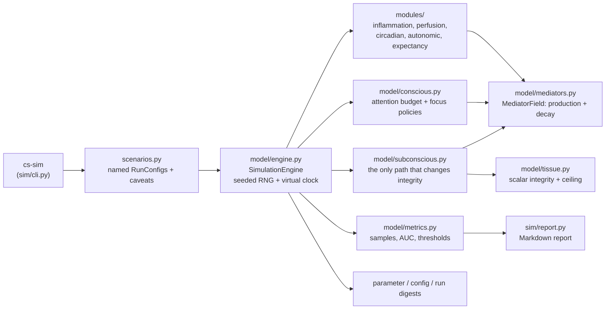
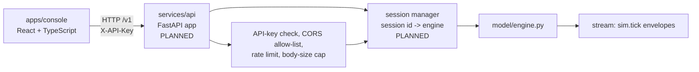
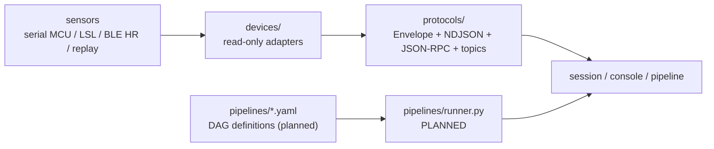
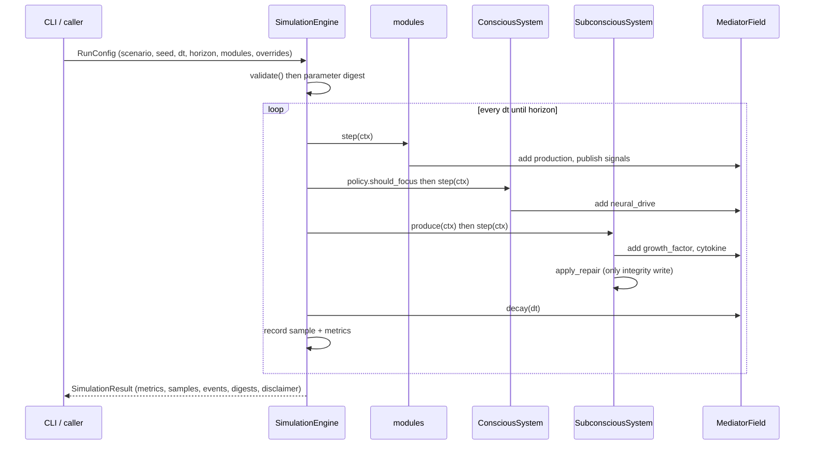

# Architecture

Three layers, one dependency direction: **nothing in `core/` imports anything from
`model/`, `modules/` or the optional layers, and nothing in the simulation core
imports a third-party package at all.**

> **Boundary.** This describes the architecture of a simulation, not a clinical
> system. See [DISCLAIMER.md](https://github.com/onegayunicorn/conscious-subconscious/blob/main/DISCLAIMER.md).

## Package layout

```
src/conscious_subconscious/
  __init__.py          __version__, DISCLAIMER, PROVENANCE_POLICY
  i18n.py              locale catalog lookup (no third-party deps)
  parameters.py        the canonical parameter set, declared once
  core/                clock, seeded RNG, event bus, ParameterSet, errors
  model/               engine, tissue, mediator field, conscious, subconscious,
                       context, metrics
  modules/             opt-in physiology-ish behaviour, registered by name
  protocols/           envelope, NDJSON codec, JSON-RPC, topics, in-process transport
  devices/             adapters (simulated, serial, LSL, BLE HR, replay)
  sim/                 scenarios, sweep/sensitivity, Markdown report, CLI
```

`core/` has **zero third-party dependencies** on purpose: the engine must run in a
bare or offline interpreter. Even `i18n.py` falls back to returning the message
key rather than importing anything.

Two naming rules that the code enforces by convention:

- A **channel** lives on `MediatorField`. It has units, it decays, and it persists
  across steps.
- A **signal** lives in `StepContext.signals`. It is dimensionless, recomputed
  every step, and nothing persists in it by accident.

## CLI path

The only fully implemented path today.



`sweep.py` sits on top of the same engine: `sweep` re-runs one scenario per
parameter value, and `sensitivity` multiplies each unsupported parameter by
`(1 ± factor)` and ranks the response of a chosen metric.

### Dependency direction inside the engine

`engine.py` constructs and owns everything: `VirtualClock`, `DeterministicRng`,
`EventBus`, `Tissue`, `MediatorField`, `SubconsciousSystem`, `ConsciousSystem`, a
`FocusPolicy`, the module tuple, and the `MetricsRecorder`. Subsystems never
import the engine; they receive a `StepContext` per step. That is what keeps the
step order in one place and makes the subsystems unit-testable on their own.

## Step order, and why it matters

Each step runs exactly this sequence — this is documented in `model/engine.py` and
covered by tests, because the order is part of the model rather than an
implementation detail:

| # | Step | What it does |
| --- | --- | --- |
| 1 | Modules | Publish derived signals, add channel production. |
| 2 | Focus decision | The policy reads current damage and attention. |
| 3 | Conscious system | Injects `neural_drive`, spends or restores attention, computes perceived progress. |
| 4 | Subconscious production | Secretes growth factors and cytokines. |
| 5 | Subconscious repair | The only code path that changes tissue integrity. |
| 6 | Field decay | Every channel decays exponentially over one `dt`. |
| 7 | Recording | Sample the state and fold it into the metrics. |

Concrete consequences, so the ordering is not mistaken for arbitrary:

- **Modules run first**, so a module that read `neural_drive` would see the
  *previous* step's value. The registry therefore forbids modules from depending on
  each other, and module names are sorted at construction so the order is stable
  whatever order a scenario lists them in.
- **Decay runs after production**, so a channel produced this step is not
  discounted until the next one.
- **Repair is step 5 and is the single write path to `Tissue.integrity`.**
  `SimulationEngine.command()` exposes only focus control, and there is
  deliberately no command that sets integrity directly. Nothing may bypass the
  repair rule — not a module, not the API, not an operator.
- **Recording is last**, so a sample always describes a fully advanced step.

Runs always execute the full horizon even after the tissue is healed. An early
exit would make a faster run look better simply by being shorter, and would make
area-under-damage incomparable between scenarios.

## API path (planned — not implemented)

`conscious_subconscious.services.api` is referenced by `pyproject.toml`
(`conscious_subconscious.services.api.__main__:main`), by `.env.example` and by
the deployment manifests. **It does not exist in this repository.** The diagram
below is the intended shape, not a description of code you can read today.



Configuration the planned service reads, from `.env.example`:
`CS_API_KEY` (the `X-API-Key` header), `CS_HOST`, `CS_PORT`, `CS_ALLOWED_ORIGINS`,
`CS_RATE_LIMIT_PER_MINUTE`, `CS_MAX_BODY_BYTES`, `CS_LOG_LEVEL`. Health endpoints
`/healthz` (liveness) and `/readyz` (readiness) are already assumed by the
container, Compose and Kubernetes manifests.

The interactive command surface is already defined and bounded by the engine:
`focus`, `release`, `set_policy` — and nothing else.

## Device and protocol path



Adapters implement a four-method surface — describe, open, read, close — and
**no shipped adapter has a write or stimulate method**. `bidirectional` defaults
to `False` and every driver that declares capabilities sets it explicitly. That
is a safety boundary, not a gap: a project that can drive a stimulator is a
different project with a different safety case.

The protocol layer is transport-agnostic. `Envelope`, the NDJSON codec, the
JSON-RPC builders and the topic helpers are pure functions over dictionaries, and
the `InProcessTransport` is the only concrete transport that ships — so the whole
wire contract is testable with no network, no broker and no port binding. That is
why the protocol layer can be exercised in CI on three operating systems in under
a second.

The TypeScript console consumes the same contract, defined once as JSON Schema in
`protocols/schemas/`. When the Python and TypeScript implementations disagree, the
schema is the tie-breaker.

## Data flow of one run



## Where the honesty is enforced in code

| Mechanism | Where |
| --- | --- |
| Every constant declared once with a grade | `parameters.py` |
| Overrides downgrade a grade to `assumed` | `core/params.py::ParameterSet.with_overrides` |
| Only one write path to tissue integrity | `model/subconscious.py::SubconsciousSystem.step` |
| No interactive command that sets integrity | `model/engine.py::SimulationEngine.command` |
| Modules may not touch tissue | `modules/base.py` contract, and no adapter has a write path |
| Determinism is provable | `run_digest` in `model/engine.py` |
| Missing values never render as zero | `sim/report.py` (`EM_DASH`) |
| The disclaimer travels with the output | `SimulationResult.disclaimer`, CLI epilog, report footer |
